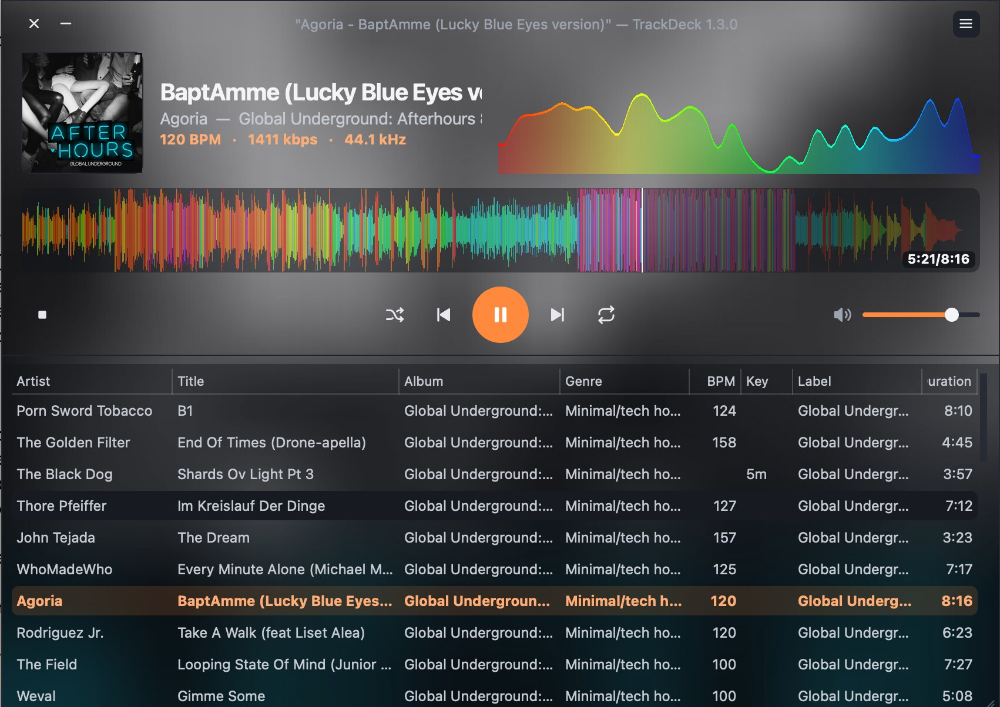
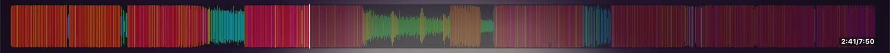
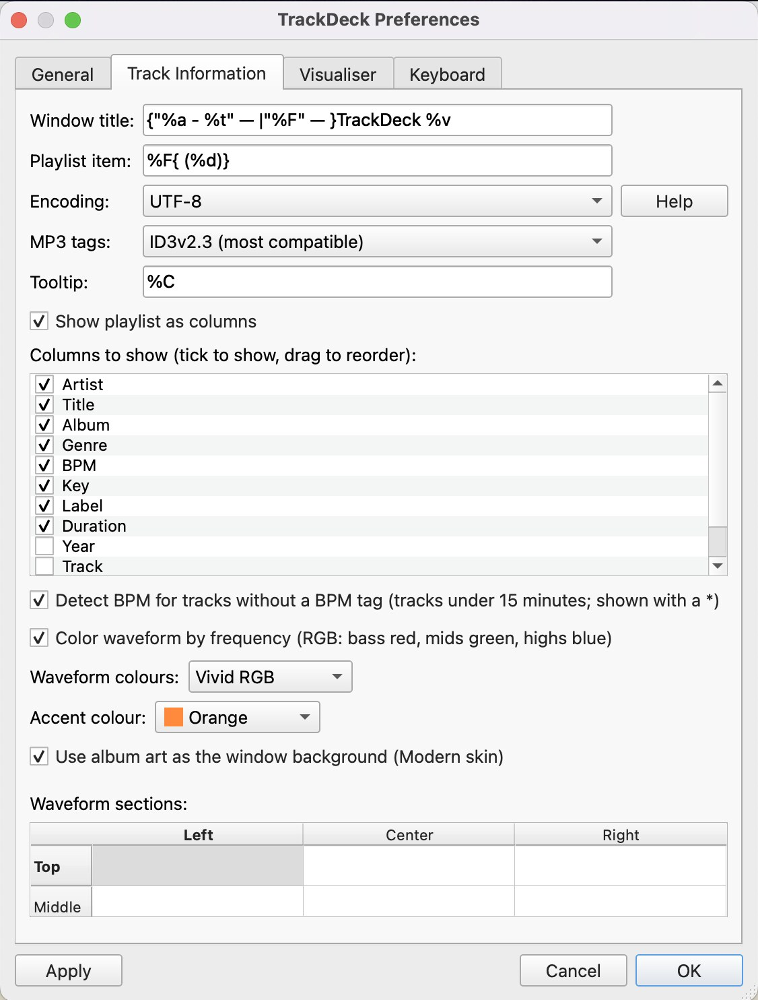
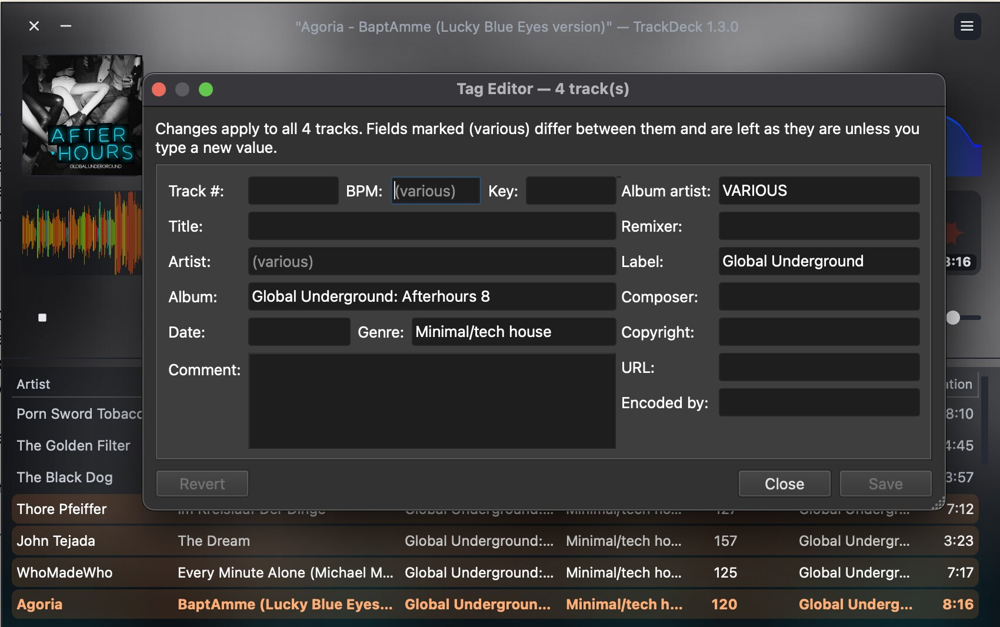

# TrackDeck

**TrackDeck** is a music player for DJs. It has an RGB waveform, a live spectrum visualiser, automatic BPM detection, tag-based playlist columns and a modern dark skin. It's based on [Nulloy](https://github.com/nulloy/nulloy) by Sergey Vlasov and is released under the same [GPL-3.0](LICENSE.GPL3) licence.

**Download:** builds for **macOS (Apple Silicon or Intel, macOS 15 Sequoia+)**, **macOS 12 Monterey+ (Intel)** and **Windows 10/11 (x64)** are in the [releases](https://github.com/khoshekh-dj/trackdeck/releases). For other older Macs, see [Older Macs](#older-macs) below.
- macOS: open the `.dmg` and drag TrackDeck to Applications. The app isn't notarized, so the first time, right-click it and choose **Open**.
- Windows: an installer (`…-Setup.exe`) or a portable `.zip`. The installer installs just for you, with no admin password, and adds TrackDeck to the Start menu; settings go in `%AppData%\TrackDeck`. The `.zip` runs from anywhere, e.g. a USB stick: unzip it and run `TrackDeck\TrackDeck.exe`; it keeps its settings in the same folder. If SmartScreen warns about either, choose **More info → Run anyway**.

## Features

### Modern skin
A dark design with large cover art, the title, artist and album, a BPM · kbps · kHz line, a rounded waveform, centred controls and a clean playlist. This is the default skin.
- **Accent colour:** choose from presets (electric blue, neon green, pink, orange, purple, red, teal) or pick your own in Preferences → Track Information.
- **Album art as the background:** the current track's cover, blurred and darkened, fills the window behind the player.
- **Khoshekh skin:** the same layout in a deep teal and cream palette.

To switch skins, use Preferences → General → Skin, then restart TrackDeck.




### RGB waveform
The waveform is coloured by frequency, with bass in red, mids in green and highs in blue. Choose RGB (balanced), Vivid RGB or your accent colour in Preferences → Track Information. You can also untick *Color waveform by frequency* to turn the colours off.



### Live spectrum visualiser
A real-time frequency display, like a graphic EQ, to the right of the track info. The bars are timed to what you hear, not to what has just been decoded. Preferences → Visualiser lets you choose:
- the style: bars, LED segments, mirrored or a smooth curve
- how many bars, how sensitive they are, how much the treble is boosted, and how fast they fall
- 30 or 60 frames per second, with or without peak caps
- colours that follow the waveform, use your accent colour, or a custom bass-to-treble gradient

It uses about 7% of one CPU core at 30 frames per second on an Apple Silicon Mac. To turn it off, untick *Show the live spectrum visualiser*.


### BPM detection
For tracks without a BPM tag, TrackDeck works out the tempo the first time you play them, using [aubio](https://aubio.org). The result appears in the BPM column and on the track info line with a `*` (for example `126.1*`), so you can tell it from a BPM tag, and it's remembered, so each track is analysed only once. Tracks of 15 minutes or longer are skipped, because they're most likely DJ mixes. To turn it off, untick Preferences → Track Information → *Detect BPM for tracks without a BPM tag*.

### Playlist columns
The playlist can show columns from your tags: Artist, Title, Album, Genre, Key, Label, BPM, Year, Track, Bitrate and Duration. In Preferences → Track Information, tick the columns you want and drag them into order. Columns are resizable. To turn them off, untick *Show playlist as columns*.




### Playlists
Save the current list as a playlist (**Save Playlist As…**, Shift+Cmd+S), open one (**Open Playlist…**, Cmd+L, or **Open Recent Playlist**), and right-click tracks to **Add to Playlist ▸** an existing playlist or a new one, without leaving the list you're on. Playlists are `.m3u8` files in `~/Music/TrackDeck Playlists` (configurable in Preferences → General), so rekordbox, Serato, Engine DJ and most players can import them. When opening a playlist, TrackDeck asks whether to replace the current list or add to it; Preferences sets a default. **Save Playlist** (Cmd+S) updates the playlist you opened.

### Tag editor
Select one or more tracks, right-click and choose **Tag Editor** (F4). For one track you can edit every tag, including the raw ones. For several tracks, type into a field such as Genre, Label or Album artist and it changes on all of them. Fields marked *(various)* differ between the tracks and stay as they are unless you type a new value. Titles and track numbers are edited one track at a time.

The fields are Title, Artist, Album, Album artist, Remixer, Date, Genre, BPM, Key, Label, Comment, Composer, Copyright, URL and Encoded by. Each format gets its own tag standard: ID3v2 for MP3, AIFF and WAV; Vorbis comments for FLAC, Ogg and Opus; and iTunes atoms for M4A. MP3 tags are written as **ID3v2.3**, the version DJ software, CDJs and Windows read most reliably; Preferences → Track Information can switch to ID3v2.4. Saving only changes the tags you edited. Cover art and the data DJ software keeps in the file are left as they are, including Serato cue points and Traktor analysis. Tracks that are still in iCloud Drive or OneDrive and not downloaded are left out, so the app doesn't freeze while they download.



### Also
- **Formats:** MP3, AAC/M4A, Apple Lossless (ALAC), FLAC, WAV, AIFF, Ogg Vorbis, Opus, WMA, AC3 and more. WavPack works on Windows.
- **Mac media keys and Now Playing:** F7, F8 and F9, headphone buttons and Control Center can play, pause and skip tracks.
- **Window stays reachable:** if TrackDeck was last closed on a display that's no longer connected, it opens on your main screen.
- **Dark pop-up menus** in the Modern skin.
- **Crash fix:** blank global shortcuts were registered as the "A" key system-wide, which made typing "a" pop up the player and could crash it.

## Credits and licence

- TrackDeck is a fork of [Nulloy](https://github.com/nulloy/nulloy), Copyright (C) 2010-2024 Sergey Vlasov. TrackDeck modifications are copyright (C) 2026 Khoshekh.
- TrackDeck is free software under the [GNU GPL v3](LICENSE.GPL3).
- Skins are CC-BY-SA 3.0. The Modern and Khoshekh skins build on the skin scripts of Nulloy's Metro, Silver and Slim skins by Sergey Vlasov.
- BPM detection uses [aubio](https://aubio.org) (GPL-3.0).
- "Nulloy" is the name of the original project. TrackDeck is not affiliated with or endorsed by it.
- The macOS and Windows builds bundle Qt, GStreamer, TagLib, aubio and their dependencies. Their licences are in `TrackDeck.app/Contents/Resources/Licenses` on macOS and in the `licenses` folder on Windows.

## Build Instructions

<details>
<summary>Windows</summary>

TrackDeck builds on Windows with [MSYS2](https://www.msys2.org/), the same way the release builds are made.

### Prerequisites

Install MSYS2, open the **MSYS2 UCRT64** shell and install the toolchain and libraries:

```sh
pacman -S --needed make zip git \
  mingw-w64-ucrt-x86_64-{toolchain,qt5-base,qt5-script,qt5-svg,qt5-tools,qt5-winextras} \
  mingw-w64-ucrt-x86_64-{gstreamer,gst-plugins-base,gst-plugins-good,gst-plugins-bad,gst-plugins-ugly,gst-libav} \
  mingw-w64-ucrt-x86_64-{taglib,aubio,imagemagick,librsvg,pkgconf,ntldd,ffmpeg}
```

### Build & Run TrackDeck

In the same shell:

```sh
cd trackdeck
QMAKE=$(command -v qmake-qt5 || command -v qmake) \
LRELEASE=$(command -v lrelease-qt5 || command -v lrelease) \
./configure
make -j"$(nproc)"
```

### Windows packaging

To build a portable `TrackDeck` folder and `.zip` that run without MSYS2:

```sh
scripts/package-windows.sh "$PWD/dist/TrackDeck-windows"
# -> dist/TrackDeck-windows.zip
```

The script copies Qt, an audio-only set of GStreamer plugins and every DLL they need, and collects their licences.

To build the installer from that folder, install [Inno Setup 6](https://jrsoftware.org/isinfo.php) and run, from a Windows command prompt:

```bat
"C:\Program Files (x86)\Inno Setup 6\ISCC.exe" /DAppVersion=1.3.2 scripts\windows-installer.iss
:: -> dist\TrackDeck-1.3.2-Windows-x64-Setup.exe
```

Release builds make both on GitHub Actions; see `.github/workflows/windows.yml`.
</details>

<details>
<summary>macOS</summary>

### Prerequisites
* Xcode Command Line Tools
* MacPorts http://www.macports.org/ or HomeBrew https://brew.sh/

### Environment

Install Xcode Command Line Tools:

```sh
xcode-select --install
```

### Dependences

First install either MacPorts or HomeBrew.

### MacPorts

After installing MacPorts:

```sh
sudo port install pkgconfig qt5 qt5-qtscript qt5-qttools gstreamer1 gstreamer1-gst-plugins-base taglib aubio ImageMagick librsvg
export PATH=/opt/local/libexec/qt5/bin:$PATH
# install extra GStreamer plugins for more audio formats
sudo port install gstreamer1-gst-plugins-good gstreamer1-gst-plugins-bad gstreamer1-gst-plugins-ugly

cd trackdeck
./configure
make
open TrackDeck.app
```

### HomeBrew

After installing HomeBrew:

```sh
brew install pkgconfig qt5 gstreamer gst-plugins-base taglib aubio imagemagick librsvg
export PATH=/usr/local/opt/qt/bin:$PATH
# install extra GStreamer plugins for more audio formats
brew install gst-plugins-good gst-plugins-bad gst-plugins-ugly

cd trackdeck
./configure
make
open TrackDeck.app
```

On Apple Silicon, Homebrew installs Qt 5 as `qt@5` under `/opt/homebrew`. Use these steps instead:

```sh
brew install qt@5 gstreamer taglib aubio imagemagick librsvg
export PATH="$(brew --prefix qt@5)/bin:$PATH"
./configure
make
```

### macOS packaging

To build a standalone `TrackDeck.app` and `TrackDeck.dmg` that run without Homebrew, start from a Homebrew build as above:

```sh
scripts/package-mac.sh "$PWD/TrackDeck.app" "$PWD/dist/TrackDeck"
# -> dist/TrackDeck.dmg
```

The script:
- bundles Qt, aubio and an audio-only set of GStreamer plugins
- strips local settings and playlists
- checks that nothing still depends on Homebrew
- ad-hoc signs the app

The result is not notarized, so on first launch right-click the app and choose **Open**. It runs on the same CPU architecture as the Homebrew it was built from.

### Older Macs

The main release builds need macOS 15 Sequoia or newer, because Homebrew's libraries only support recent macOS. Each release also has a `macOS12-Intel` download for Intel Macs on macOS 12 Monterey or newer, built with MacPorts on a Monterey Mac (`.github/workflows/macos-12.yml`, a self-hosted runner). Its first launch takes a minute or two while it scans its audio plugins.

To build for another older Mac, such as an Apple Silicon Mac on macOS 12 or 13, use MacPorts, which compiles everything for the Mac it runs on:

```sh
xcode-select --install          # Xcode Command Line Tools
# install MacPorts for your macOS version from https://www.macports.org/install.php
scripts/build-mac-macports.sh   # first run compiles Qt and GStreamer: a few hours
# -> dist/TrackDeck-<version>-macOS<N>-<chip>.dmg, runs on that macOS and newer
```

### Xcode

Generate Xcode project file:

```sh
cd trackdeck
./configure --xcode
open nulloy.xcodeproj
```
Build `widget_collection`, `plugin_taglib` and `plugin_gstreamer` targets. It may take several attempts to build, but it should succeed eventually.
Build and run the `TrackDeck` target.
</details>

<details>
<summary>Linux</summary>

### Dependences

#### DEB-based distro

```sh
apt install g++ qttools5-dev qtscript5-dev qtbase5-private-dev libqt5x11extras5-dev libgstreamer-plugins-base1.0-dev libgstreamer1.0-dev zip libx11-dev libx11-xcb-dev libtag1-dev libaubio-dev imagemagick librsvg2-bin libqt5svg5-dev
# install extra GStreamer plugins for more audio formats
apt install gstreamer1.0-plugins-good gstreamer1.0-plugins-bad gstreamer1.0-plugins-ugly
```

#### RPM-based distro

```sh
yum install gcc-c++ qt5-qtbase-devel qt5-qttools-devel qt5-qttools-static qt5-qtscript-devel qt5-qtbase-private-devel qt5-linguist gstreamer1-plugins-base-devel gstreamer1-devel zip libX11-devel libxcb-devel taglib-devel aubio-devel ImageMagick librsvg2 qt5-qtsvg-devel
# install extra GStreamer plugins for more audio formats
yum install gstreamer1-plugins-good gstreamer1-plugins-bad gstreamer1-plugins-ugly
```

### Build & Run TrackDeck

```sh
cd trackdeck
./configure
make
./trackdeck
```
</details>

## License
[GPL3](/LICENSE.GPL3)
